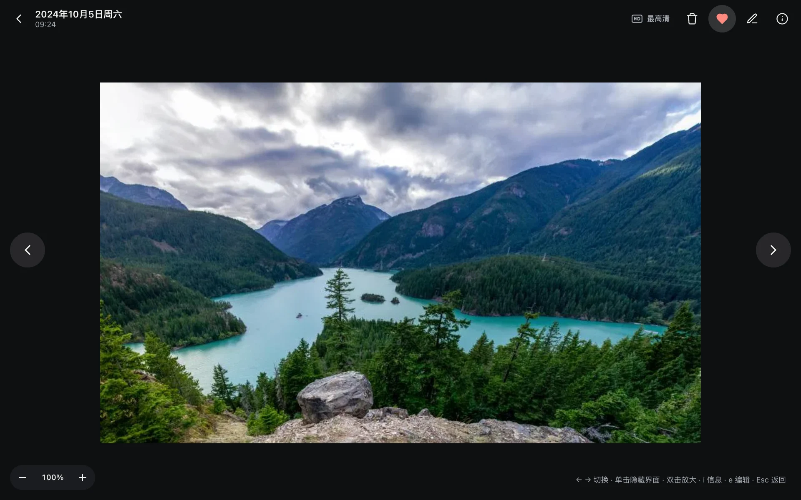
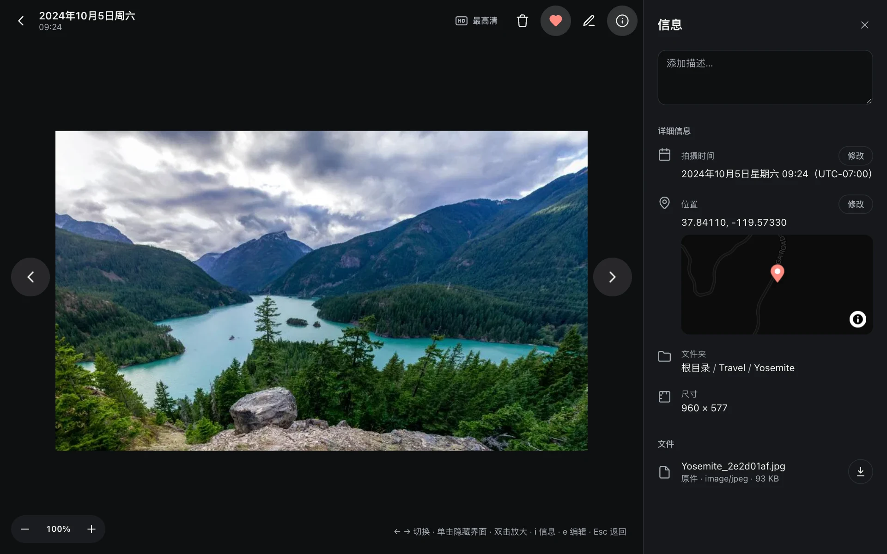

## 时间线

首页是时间线：按拍摄日期（拍摄地的本地日期）从新到旧排列。连拍会折叠成一张封面，点开查看整组。

右侧的**拖动条**可以直接跳到任意年月：悬停或滚动时出现半圆手柄，拖动时显示月份。快速滚动、拖动期间先显示占位格子，停下来再加载照片。

几万张照片也一样流畅：时间线只渲染屏幕附近的部分。

## 查看器

点开任意照片进入查看器：

- 先显示预览（长边 3840，覆盖 4K 屏幕），放大到预览不够清晰时，停留片刻会自动叠加原图。
- **Live Photo** 打开时静音播放一次，鼠标悬停再播放；左上角的 Live 按钮点一下播放，长按（或右键）切换自动播放。
- **视频**优先播原件（浏览器能解码 HEVC 时），否则播转码好的 H.264 版本。
- 单击照片隐藏所有按钮（沉浸模式），再单击恢复；双击放大。

### 快捷键

| 键 | 作用 |
|---|---|
| ← → | 上一张 / 下一张 |
| i | 信息面板 |
| e | 编辑 |
| f | 收藏 |
| Esc | 返回 |

### 信息面板

拍摄时间（带时区）、相机和镜头参数、文件大小、位置小地图和地名、照片里的人物、相似照片。切换照片时面板保持打开。

### 加载原图（HD）

顶栏的 HD 按钮：

- 预览已经覆盖原图分辨率时，提示“已经是最高清”。
- 浏览器能直接显示的原件（JPEG、PNG、Safari 上的 HEIC 等，不超过 40 MB / 6000 万像素）直接叠上去。
- 其他的（非 Safari 的 HEIC、RAW、超大图）会在后台按原图分辨率重新生成一次预览，几十秒后自动换上。每张照片最多生成一次。

## 幻灯片

文件夹和相册页面右上角的“幻灯片”：顺序或随机播放，视频跳过。
