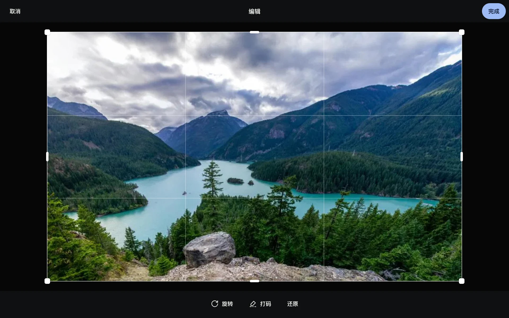

**原件永远不会被修改。** 编辑只改缩略图和预览，下载原件拿到的还是上传时的文件。

## 旋转、裁切、打码

查看器顶栏的编辑按钮（或按 `e`）：

- **旋转**：每次 90°。
- **裁切**：拖动裁切框；只改角度时，框会跟着转。
- **打码**：在照片上涂抹，涂过的地方在缩略图和预览里变成毛玻璃。可以撤销、全部清除。
  - 被打码盖住的脸不再参与人物识别（移出所在的人物）；去掉打码后会重新识别。
  - 放大或“加载原图”时叠加的是原件，仍然是清晰的——打码是为了缩略图和预览，不是销毁信息。

保存后先用 CSS 显示编辑效果，后台重新生成缩略图和预览（一次容器处理，几秒到十几秒），好了自动换上。视频不能编辑。

## 拍摄时间、位置、描述

在信息面板里点对应的字段修改：

- **拍摄时间**：拍摄地的本地时间 + 时区。改了之后时间线的位置跟着变。
- **位置**：在地图上选点，或者清除。
- **描述**：可以被[搜索](../search/)到。

改过的字段会被“锁住”：以后照片重新处理时，不会被 EXIF 覆盖。

## 批量修改

多选之后，在操作栏里打开修改日期和地点的对话框：

- **整体平移**：保持照片之间的先后和间隔，整体推后或提前（比如相机时钟慢了 1 小时）。各自按自己的时区重新计算日期；没有拍摄时间的照片不改。
- **设为同一时间**：把选中的照片都改成同一时刻（拍摄地的本地时间 + 时区）。
- **地点**：输入“纬度, 经度”或在地图上选，给选中的照片设同一个位置；也可以清除地点。
