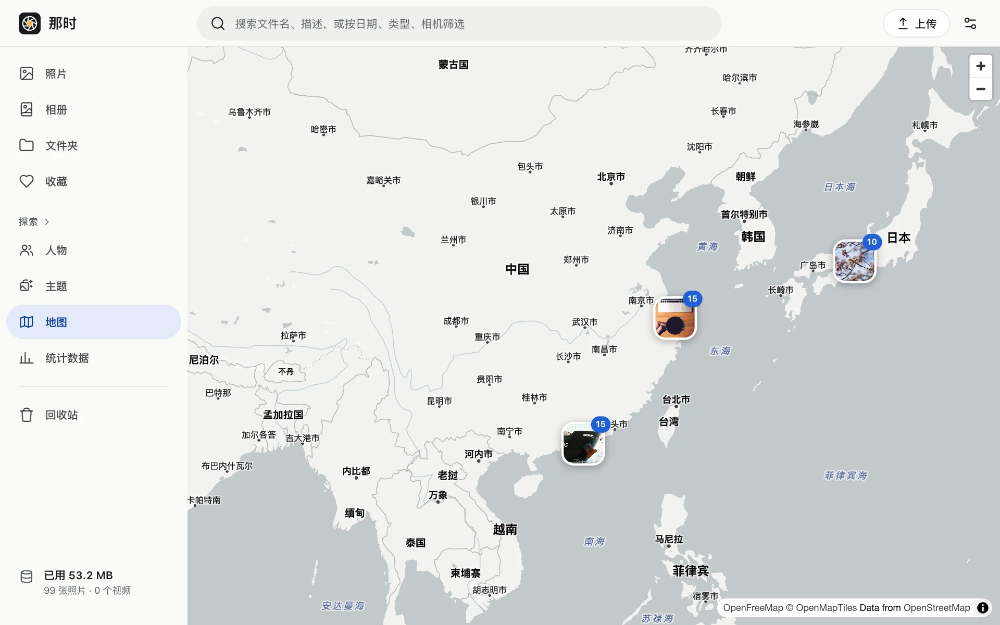

有位置信息（EXIF 里的 GPS，或者你手动设置的）的照片会显示在地图上，按网格聚合成带数字的圆点，放大后散开。点圆点查看那一片的照片。

- 地名跟随界面语言（中文 / 英文），找不到对应语言时显示当地文字。
- 查看器信息面板里的小地图和地名也来自同一份底图数据。

## 底图和隐私

底图来自 [OpenFreeMap](https://openfreemap.org)：免费、不需要 API key、自动更新。

浏览器直接向 OpenFreeMap 请求地图瓦片，所以它能看到你的 IP 和你浏览的地图范围（包括打开信息面板时那张照片附近的瓦片坐标），**看不到任何照片**。这是整个应用里唯一的外部请求。它不可用时地图打不开，其他功能不受影响。

地名不调用任何地理编码服务，只从已经加载的瓦片里找附近的城镇和片区名。
