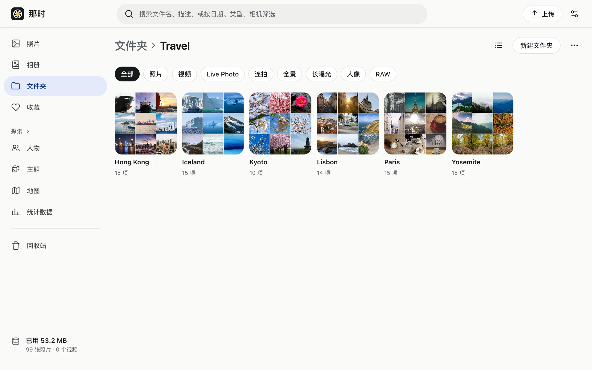

## 文件夹

文件夹是照片的“存放位置”，一张照片只在一个文件夹里，可以多层嵌套。

- 文件夹卡片显示整棵子树里最近拍的照片（九宫格 / 四宫格）。
- 页头可以切换**列表视图**：子文件夹和照片一行一个，显示文件名、大小、拍摄时间、上传时间。
- 移动：选中照片或文件夹 › 移动。不能把文件夹移进它自己的子文件夹。
- 只能删除空文件夹。
- 文件夹页面顶部有这个文件夹里的**人物**，点头像只看这个人的照片。

## 相册

相册是照片的“集合”，一张照片可以在多个相册里，删掉相册不会删照片。可以设封面。

## 收藏

查看器里点心形（或按 `f`）。收藏在 资料库 › 收藏 里。

## 类型筛选

文件夹和相册页头下面有一排筛选：照片、视频、Live Photo、连拍、全景、长曝光、人像、RAW。再点一次取消。

## 多选

- 鼠标悬停时格子左上角的勾选框；触屏上长按。
- 按住 Shift 点击选中一个范围；时间线上可以按天全选。
- 选中后底部的操作栏：收藏、加入相册、移动、下载、删除，以及修改时间、位置（见[编辑](../edit/)）。手机上不常用的操作收在“更多”里。

## 下载

- 单张：查看器或右键菜单里下载原件。
- 多张：选中后“下载”，打包成一个 zip（只存储不压缩，速度快，大于 4 GB 时自动用 ZIP64）。Live Photo 和 RAW 的附件一起打包。

## 删除与回收站

删除的照片进回收站，**30 天后自动永久删除**。在回收站里可以恢复，也可以立即永久删除（会同时删掉原件和所有缩略图、预览）。
