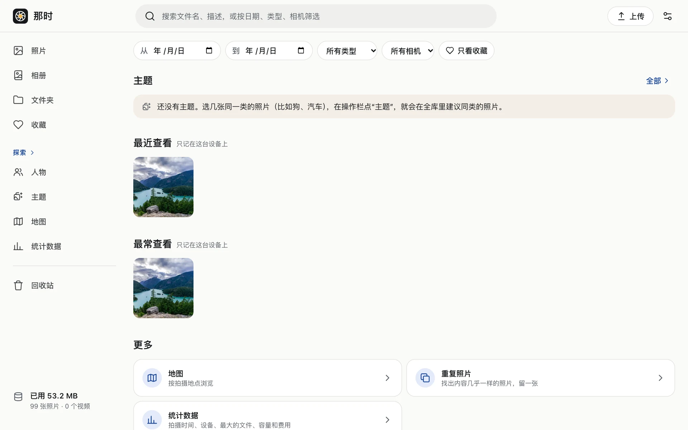

- **桌面**：顶栏的搜索框，输入就搜。
- **手机**：底部标签“探索”里的搜索框。

搜索文件名和描述。3 个字符以上走全文索引；1–2 个字符也能搜（逐行匹配，照片多时稍慢）。

可以按日期范围、类型（照片 / 视频 / Live Photo / 连拍 / 全景 / 长曝光 / 人像 / RAW）、相机、是否收藏筛选。

## 探索页

没有输入搜索词时，探索页是入口：人物、主题、最近查看 / 最常查看、地图、重复照片、按类型浏览。

“最近查看 / 最常查看”只记在这台设备的浏览器里，不发给服务器。

:::note
搜索不认识照片里的内容（比如搜“狗”找不到没写描述的狗照片）。按内容找照片用[主题](../similar/#主题)。
:::
