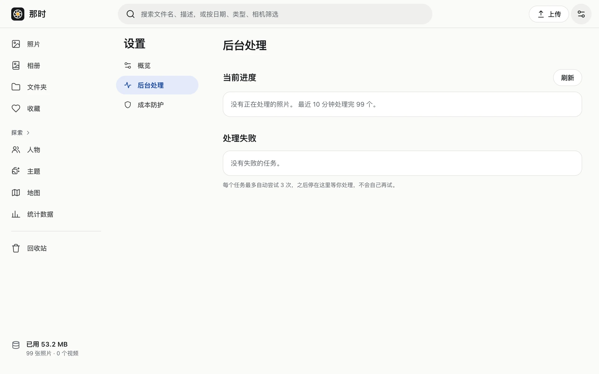
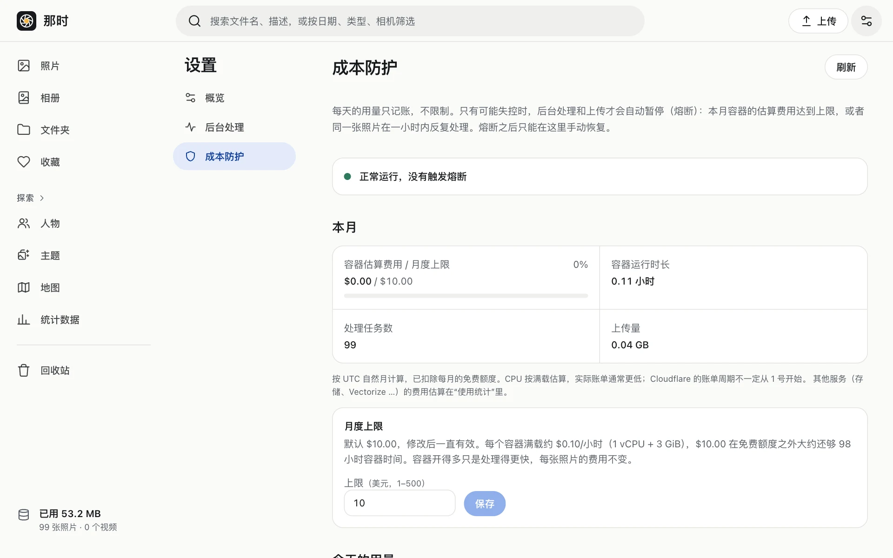

## 概览

本月容器费用和月度上限、同时运行的容器数、外观（跟随系统 / 浅色 / 深色）、语言（简体中文 / English）、当前登录的账号和退出、版本号。外观和语言是**这台设备**的偏好，不同设备可以不同。

## 后台处理

- 这一批的进度、最近 10 分钟的速度、正在处理和排队的照片（带文件名）。有任务时页面会自动刷新一段时间。
- **重新排队**：任务卡住或者排队消息丢失时点它，补发一批。连点会轮到下一批。
- **停止**：在列表里停止排队中或卡住的任务，它们记为失败，之后可以在“处理失败”里重试。
- **处理失败**：最近失败的任务和原因，可以单个或全部重试。
- 开着[设备端处理](../../device/install/)时，这里会显示是哪台设备在处理。

## 成本防护

- **本月容器费用**和**月度上限**（默认 $10，可以改成 $1–$500）。达到上限的 80% 时提醒。
- **同时运行的容器**：默认 4 个。大批量导入时可以临时调高（最多 32 个，最长 7 天，到期自动回落，也可以提前结束）。
- 今天已用的容器时间和任务数（只显示，不限制）。

### 熔断之后

页面顶部会出现提示，后台处理和上传暂停（已有照片照常浏览）。到 设置 › 成本防护 看原因：

- **达到月度上限**：确认费用合理后调高上限，再点“恢复”。不调高上限不能恢复。下个月（UTC）自动清零。
- **同一张照片反复处理**：页面列出这张照片的全部任务。停止排队中或卡住的任务，再点“恢复”。之后可以照常重试它。
