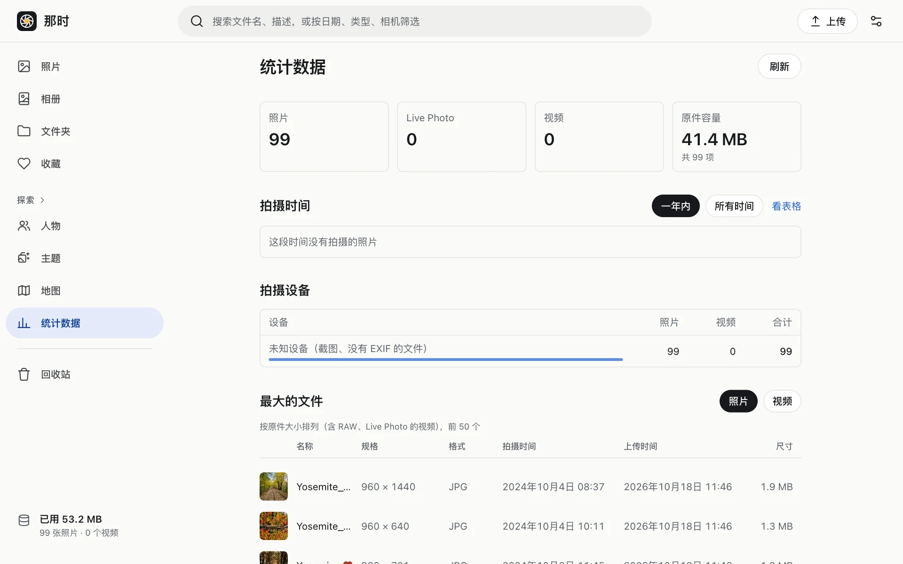

探索 › 统计数据，从上到下：

- **概览**：照片、视频数量和占用空间。
- **拍摄时间**：一年内每周的张数、所有时间每月（跨度很长时按年）的张数。每天统计一次。
- **拍摄设备**：按相机型号的张数。每天统计一次。
- **最大的文件**：最大的 50 张照片和 50 个视频，可以直接打开、多选、删除。
- **存储**：原图、缩略图和预览、回收站、未完成的上传各占多少。
- **费用**：本月的估算费用，按项目列出（只算应用自己能算出的项，见[费用](../../costs/)）。
- **容器时长**：本月和最近 30 天每天的容器时间、任务数、上传量。
- **增长**：按上传月份的增长。

只在打开页面和点“刷新”时读取，不会自动刷新。
