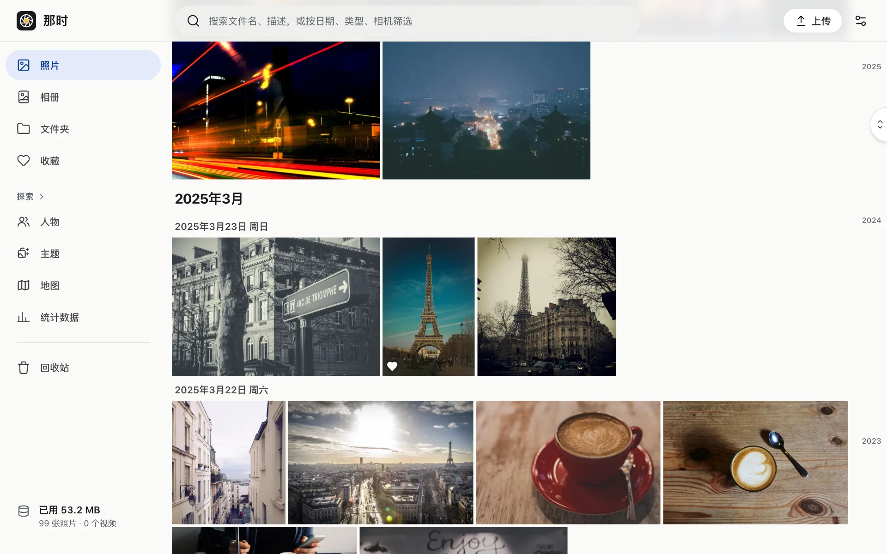

那时（Nana）是一个部署在**你自己 Cloudflare 账号**上的私人相册，用起来像 Google Photos：时间线、查看器、文件夹和相册、地图、人物、相似照片、重复照片，都在浏览器里。

## 适合谁

- 想把照片放在自己手里，又不想维护服务器、硬盘和备份脚本的人。
- 愿意花十几分钟在 Cloudflare 后台做一次性配置的人（之后基本不用管）。
- **只给一个人用**。整个站点只放行一个邮箱，没有多用户、共享链接和公开相册——这是有意的设计，不是没做完。

## 它和别的方案有什么不同

- **数据在你的账号里**：原件、缩略图、元数据、人脸向量都存在你自己的 R2、D1 和 Vectorize 里。
- **不用服务器**：整个应用是一个 Cloudflare Worker，照片处理交给按秒计费、用完就停的容器。
- **只有你能看**：所有页面和文件都在 Cloudflare Access 后面，Worker 收到每个请求还会再校验一次身份。详见[安全模型](../security/model/)。
- **账单有硬上限**：结构上没有会无限循环的东西，本月容器费用到了上限就熔断。详见[费用](../costs/)。

## 需要准备什么

| 需要 | 说明 |
|---|---|
| Cloudflare Workers Paid | $5 / 月，Containers 必须 |
| 一个托管在 Cloudflare 的域名 | 用一个子域名，比如 `photos.example.com` |
| GitHub 账号 | fork 仓库，连接 Workers Builds 自动部署 |
| 一台装了 Node 24 和 pnpm 的电脑 | 只在初始化时用一次 |

准备好了就从[部署 › 准备](../deploy/prepare/)开始。

## 名字

“那时”取自“那时候的照片”。英文名 Nana，仓库名 `nana-storage`。
