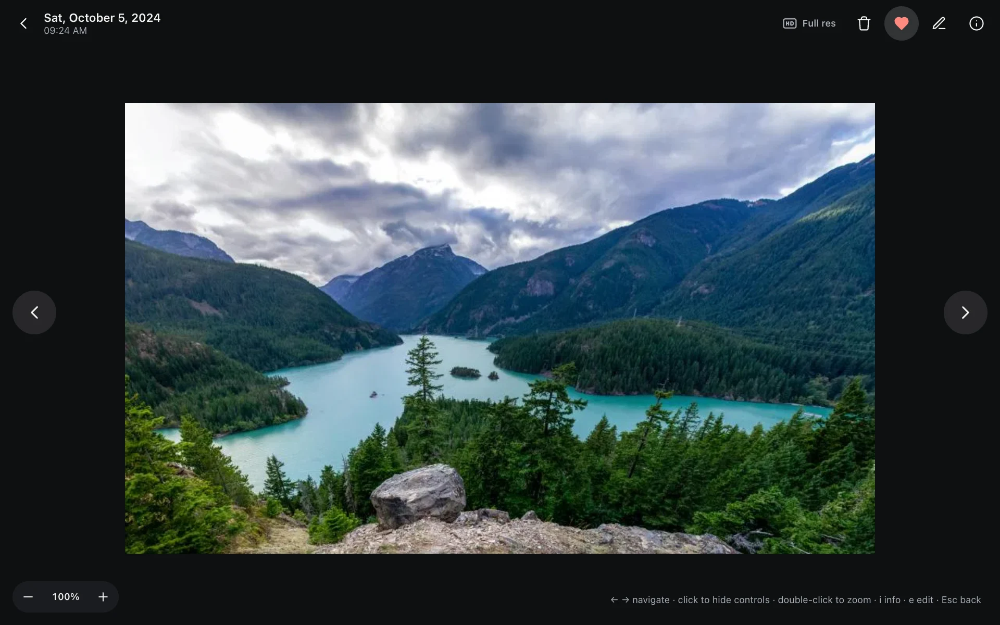
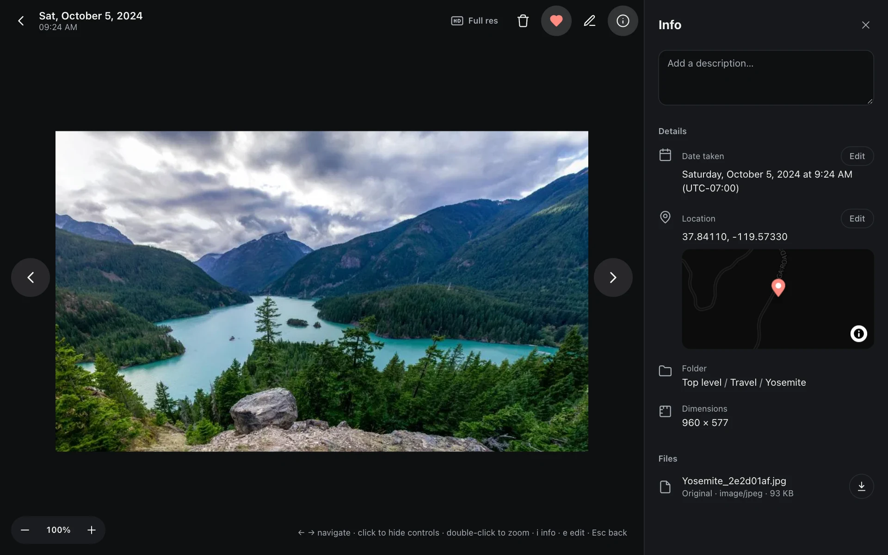

## Timeline

The home page is the timeline, newest first, by capture date (the local date where the photo was taken). Bursts fold into one cover photo; open it to see the whole burst.

The **scrubber** on the right jumps to any month: a handle appears on hover or while scrolling, and dragging shows the month. While you drag or fling, placeholder tiles show first and photos load once you stop.

It stays smooth with tens of thousands of photos: only what's near the screen is rendered.

## Viewer

Click any photo to open the viewer:

- It shows the preview first (3840 px on the long edge, enough for 4K). When you zoom past what the preview can show, the original is layered on top after a moment.
- **Live Photos** play once when opened, and again on hover, with sound (muted if the browser blocks autoplay with sound; the Live button always plays with sound). The Live button at the top left plays it; long-press (or right-click) toggles autoplay.
- **Videos** play the original when the browser can decode HEVC, otherwise the transcoded H.264 version.
- Click the photo to hide all controls (immersive mode), click again to bring them back; double-click to zoom.

### Keyboard shortcuts

| Key | Action |
|---|---|
| ← → | Previous / next |
| i | Info panel |
| e | Edit |
| f | Favorite |
| Esc | Back |

### Info panel

Date taken (with time zone), camera and lens details, file size, a mini map with the place name, people in the photo and similar photos. The panel stays open as you move between photos.

### Full resolution (HD)

The HD button in the top bar:

- If the preview already covers the original's resolution, it says so.
- Originals the browser can display directly (JPEG, PNG, HEIC in Safari…, up to 40 MB / 60 megapixels) are layered on top right away.
- Anything else (HEIC outside Safari, RAW, very large images) gets a new preview at full resolution, generated in the background and swapped in after a few dozen seconds. Each photo is generated at most once.

## Slideshow

"Slideshow" at the top right of folder and album pages plays in order or shuffled, skipping videos.
