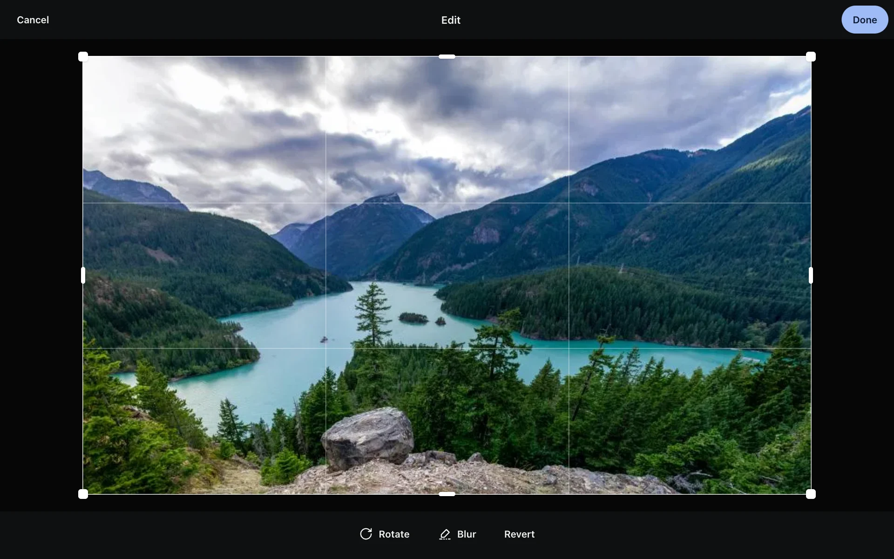

**Originals are never modified.** Edits only change thumbnails and previews; downloading the original gives you exactly the file you uploaded.

## Rotate, crop, blur

The edit button in the viewer's top bar (or `e`):

- **Rotate** in 90° steps.
- **Crop** by dragging the frame; rotating alone turns the frame with the photo.
- **Blur**: paint over areas to frost them in thumbnails and previews. Undo and clear all are available.
  - Faces covered by blur stop taking part in people recognition (they're removed from their person); remove the blur and they're recognized again.
  - Zooming in or "Full res" layers the original, which is still sharp — blur is for thumbnails and previews, not for destroying information.

After saving, the edit shows immediately via CSS while thumbnails and previews are regenerated in the background (one container pass, a few seconds) and swapped in. Videos can't be edited.

## Date, place, description

Click the field in the info panel to change it:

- **Date taken**: local time where it was taken + time zone. The photo moves on the timeline accordingly.
- **Place**: pick on a map, or clear.
- **Description**: searchable via [Search](../search/).

Edited fields are locked: reprocessing a photo never overwrites them with EXIF data.

## Editing many at once

Select photos, then open the date & place dialog from the action bar:

- **Shift all**: move them later or earlier while keeping their order and spacing (say the camera clock was an hour off). Dates are recomputed in each photo's own time zone; photos without a date are left alone.
- **Set to one time**: give all selected photos the same moment (local time + time zone).
- **Place**: type "latitude, longitude" or pick on the map to give them one location, or clear it.
