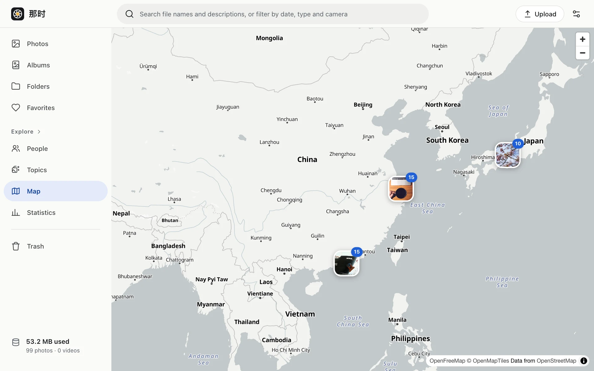

Photos with a location (GPS in EXIF, or one you set) appear on the map, clustered into numbered markers that split apart as you zoom in. Click a marker to see the photos in that area.

- Place names follow the interface language (English / Chinese), falling back to the local script.
- The mini map and place name in the viewer's info panel come from the same map data.

## Base map and privacy

The base map is [OpenFreeMap](https://openfreemap.org): free, no API key, kept up to date.

Your browser requests map tiles from OpenFreeMap directly, so it can see your IP address and the area you browse (including the tiles around a photo when you open its info panel). **It never sees any photo.** This is the only outside request in the whole app. If it's down, the map doesn't load; nothing else is affected.

Place names don't use any geocoding service; they're looked up among towns and districts in the tiles already loaded.
