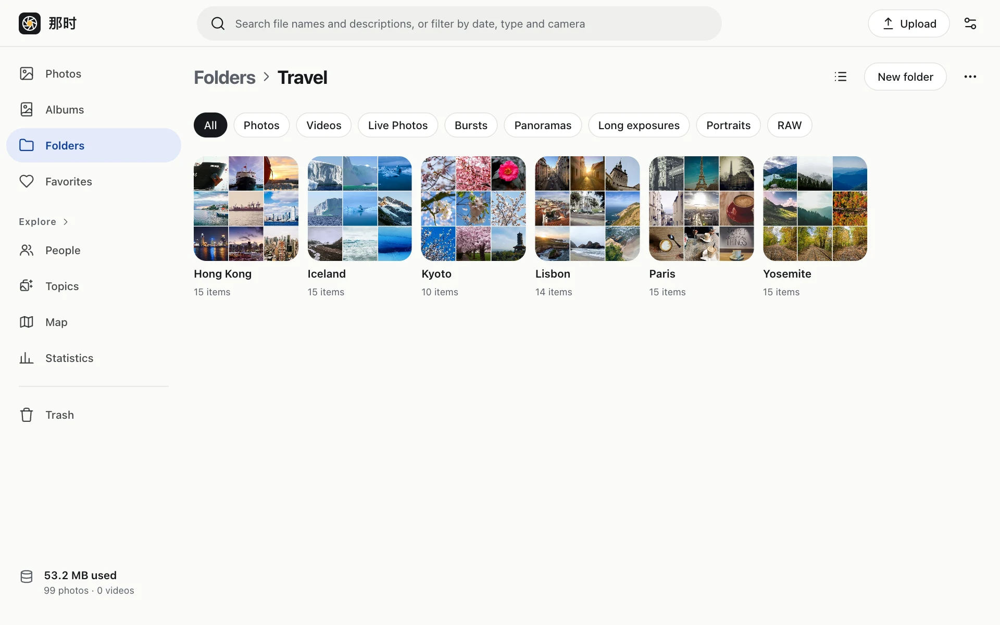

## Folders

A folder is where a photo is stored: each photo is in exactly one folder, and folders can nest.

- A folder card shows the most recent photos from its whole subtree (a 3×3 or 2×2 grid).
- Switch to **list view** in the header: one row per subfolder and photo, with file name, size, date taken and upload date.
- Move: select photos or folders › Move. A folder can't be moved into its own subfolder.
- Only empty folders can be deleted.
- The top of a folder page shows the **people** in it; tap a face to see only their photos.

## Albums

An album is a collection: a photo can be in many albums, and deleting an album doesn't delete photos. Albums can have a cover.

## Favorites

Tap the heart in the viewer (or press `f`). Favorites live under Favorites in the sidebar.

## Filter by type

Folder and album pages have a row of filters under the header: Photos, Videos, Live Photos, Bursts, Panoramas, Long exposures, Portraits, RAW. Tap again to clear.

## Selecting

- The checkbox at a tile's top-left on hover; long-press on touch screens.
- Shift-click selects a range; on the timeline you can select a whole day.
- The action bar then offers Favorite, Add to album, Move, Download, Delete, and editing date & place (see [Editing](../edit/)). On phones, less common actions sit under "More".

## Downloading

- One photo: download the original from the viewer or the context menu.
- Several: select and Download to get one zip (stored, not compressed, so it's fast; ZIP64 above 4 GB). Live Photo videos and RAW attachments are included.

## Delete and trash

Deleted photos go to the trash and are **permanently deleted after 30 days**. In the trash you can restore them or delete them for good right away (removing the original and every thumbnail and preview).
