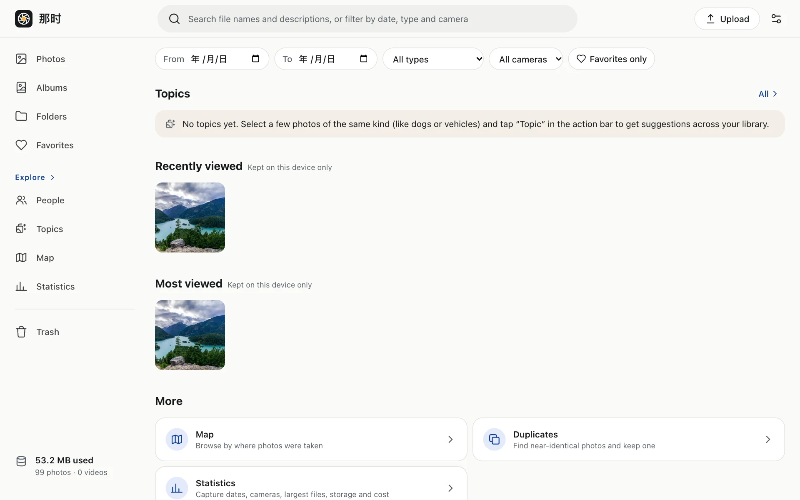

- **Desktop**: the search box in the top bar; results appear as you type.
- **Phone**: the search box on the Explore tab.

Search covers file names and descriptions. Three or more characters use the full-text index; one or two characters also work (a slower scan on big libraries).

Filter by date range, type (photo / video / Live Photo / burst / panorama / long exposure / portrait / RAW), camera and favorites.

## The Explore page

With no query, Explore is a hub: People, Topics, recently / most viewed, Map, Duplicates, Statistics and browse by type.

"Recently viewed / most viewed" is stored only in this browser and never sent to the server.

:::note
Search doesn't understand what's in a photo (searching "dog" won't find dog photos without a description). To find photos by content, use [Topics](../similar/#topics).
:::
