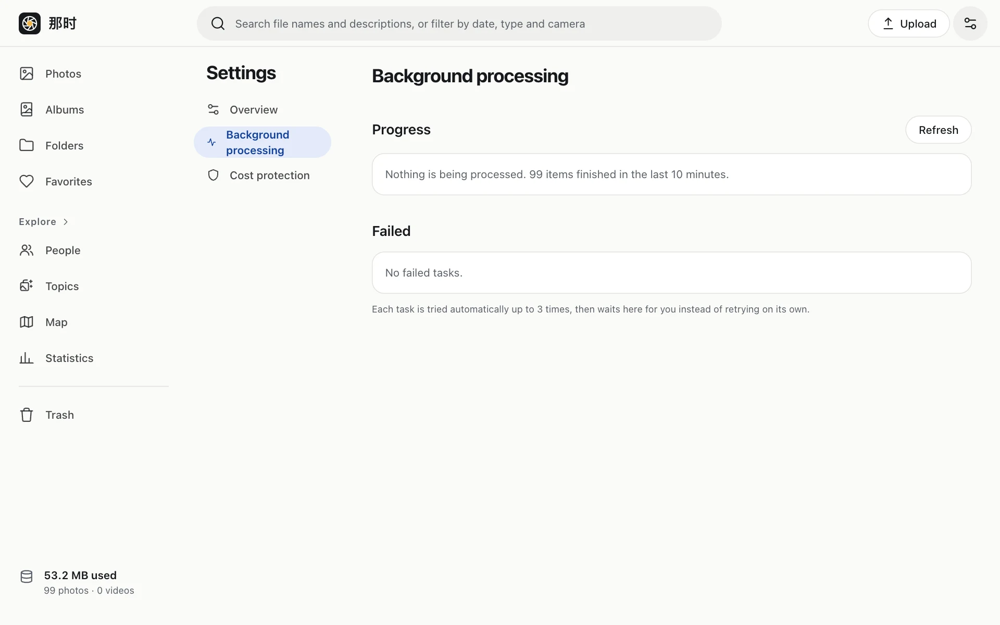
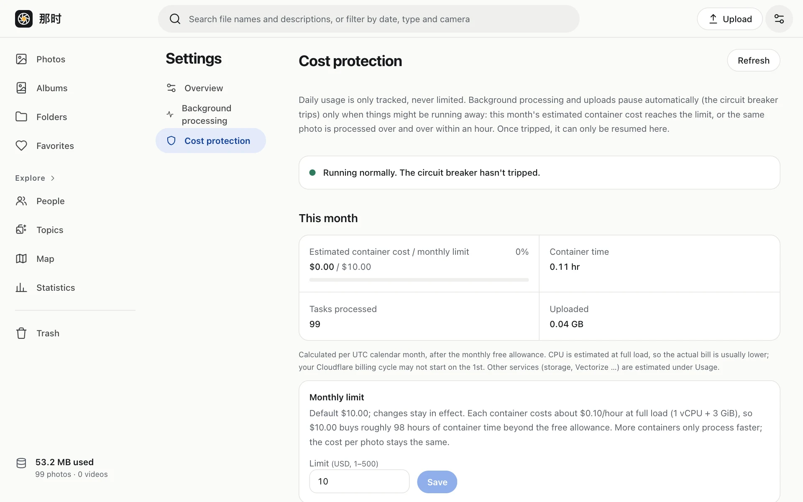

## Overview

This month's container cost and monthly cap, containers running at once, appearance (system / light / dark), language (English / 简体中文), the signed-in account and sign out, and the version. Appearance and language are preferences of **this device**; each device can differ.

## Background processing

- Progress of the current batch, the speed over the last 10 minutes, and photos being processed and queued (with file names). The page refreshes itself for a while when jobs are running.
- **Requeue**: when jobs are stuck or queue messages got lost, this re-sends a batch. Clicking again moves on to the next batch.
- **Stop**: stop queued or stuck jobs in the list; they're marked failed and can be retried later under failed jobs.
- **Failed**: recent failures with reasons; retry one or all.
- With [on-device processing](../../device/install/) running, it shows which device is processing.

## Cost protection

- **This month's container cost** and the **monthly cap** ($10 by default, adjustable from $1 to $500). You're warned at 80%.
- **Containers running at once**: 4 by default. For a big import, raise it temporarily (up to 32, for at most 7 days; it falls back automatically, or end it early).
- Today's container time and jobs (shown only, never limited).

### After the breaker trips

A notice appears at the top, and background processing and uploads pause (browsing works as usual). Go to Settings › Cost protection to see why:

- **Monthly cap reached**: once you've checked the spending is expected, raise the cap and click Resume. It can't resume without a higher cap. It resets next month (UTC).
- **One photo processed over and over**: the page lists all of that photo's jobs. Stop the queued or stuck ones, then click Resume. You can retry it normally afterwards.
