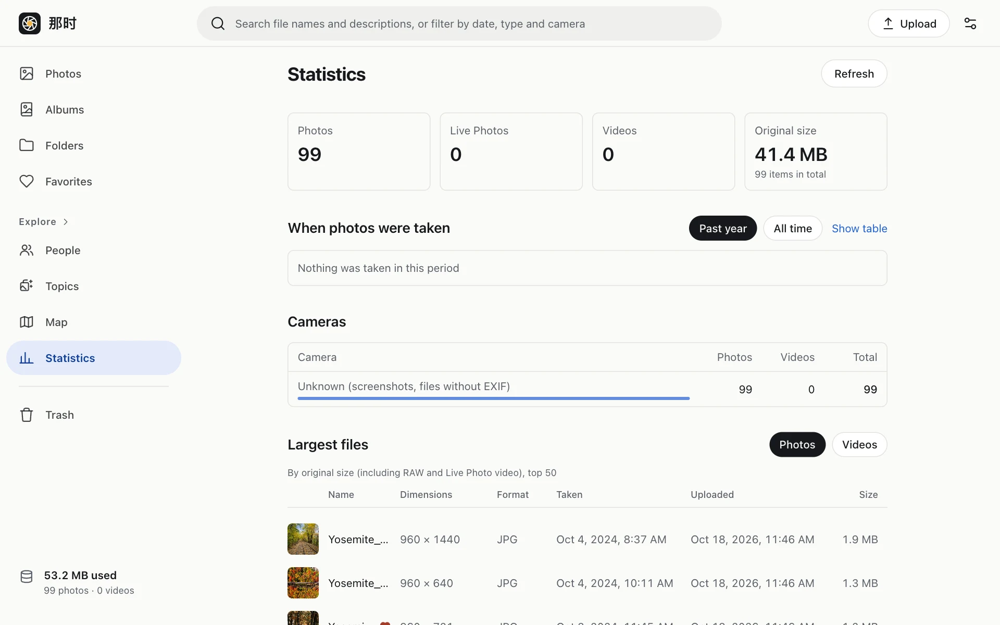

Explore › Statistics, top to bottom:

- **Overview**: number of photos and videos and the space they use.
- **Capture dates**: photos per week over the last year, and per month (per year for long spans) across all time. Computed once a day.
- **Cameras**: photos per camera model. Computed once a day.
- **Largest files**: the 50 largest photos and 50 largest videos; open, select and delete them right there.
- **Storage**: originals, thumbnails and previews, trash and unfinished uploads.
- **Cost**: this month's estimated cost by item (only what the app can compute; see [Costs](../../costs/)).
- **Container time**: container time, jobs and uploads per day for this month and the last 30 days.
- **Growth**: by upload month.

It only loads when you open the page or click Refresh; nothing refreshes automatically.
