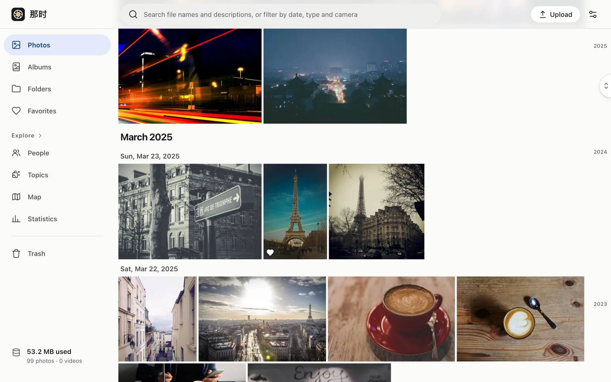

Nana (那时, "back then") is a private photo library that runs in **your own Cloudflare account**. It works like Google Photos: timeline, viewer, folders and albums, map, people, similar photos and duplicates, all in the browser.

## Who it's for

- People who want to keep their photos in their own hands without looking after a server, disks and backup scripts.
- People willing to spend a quarter of an hour on one-time setup in the Cloudflare dashboard (after that, there's little to do).
- **One person.** The whole site lets in a single email address. There are no extra users, share links or public albums — by design, not because they're missing.

## How it differs

- **Your data, your account**: originals, thumbnails, metadata and face vectors live in your own R2, D1 and Vectorize.
- **No server**: the app is one Cloudflare Worker; processing runs in containers billed by the second that stop when idle.
- **Only you can see it**: every page and file sits behind Cloudflare Access, and the Worker checks your identity again on every request. See [Security model](../security/model/).
- **A hard cap on the bill**: nothing in the design can loop forever, and a circuit breaker trips when this month's container spend reaches your cap. See [Costs](../costs/).

## What you need

| You need | Notes |
|---|---|
| Cloudflare Workers Paid | $5 / month, required for Containers |
| A domain on Cloudflare | You'll use a subdomain such as `photos.example.com` |
| A GitHub account | To fork the repository and connect Workers Builds |
| A computer with Node 24 and pnpm | Only for the one-time setup |

Ready? Start with [Deploy › Prepare](../deploy/prepare/).
